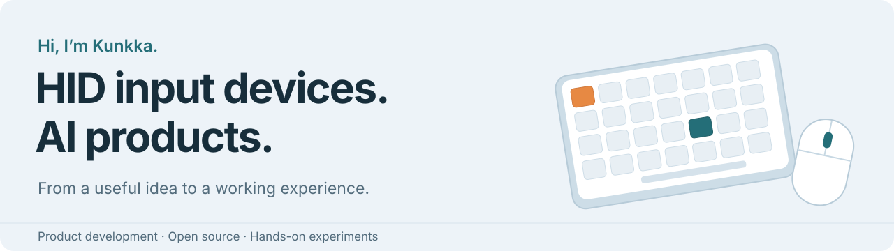
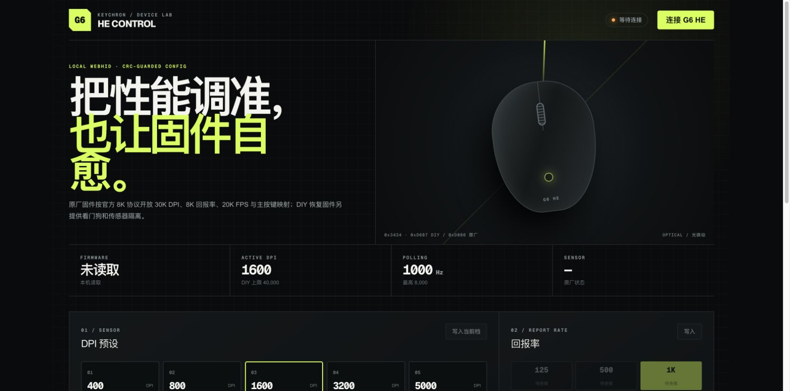
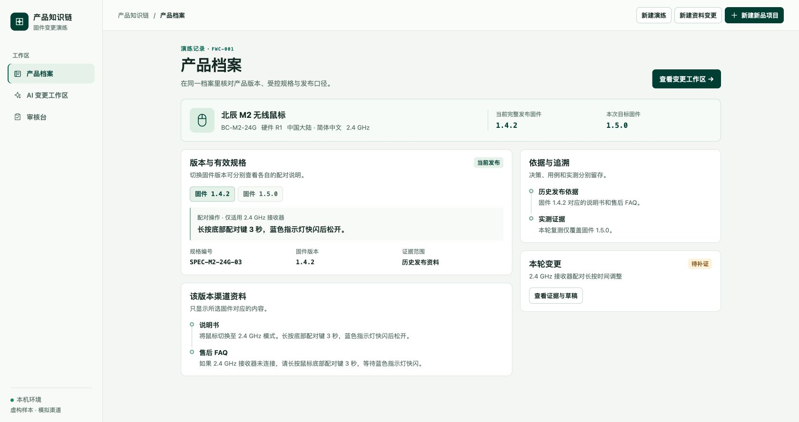
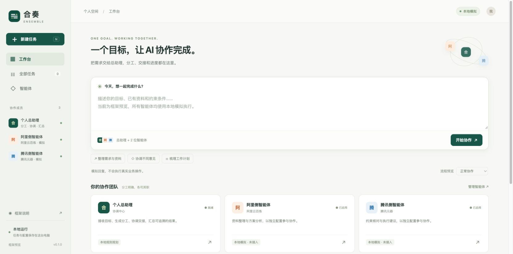
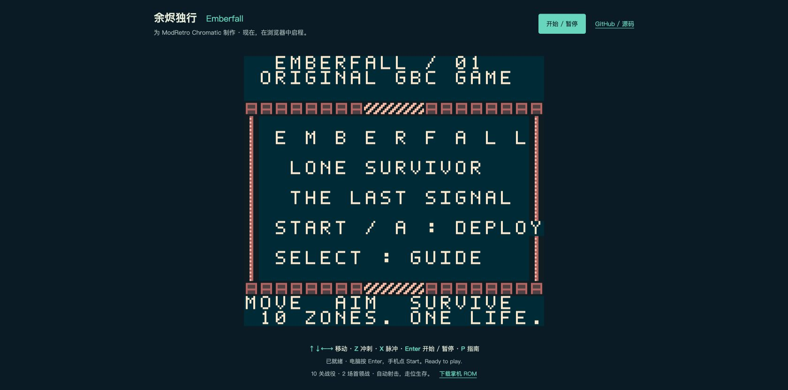

  

  <a href="#about">English</a> &nbsp; / &nbsp;
  <a href="#中文介绍">中文</a> &nbsp; / &nbsp;
  <a href="#selected-projects">Selected projects · 代表项目</a> &nbsp; / &nbsp;
  <a href="https://x.com/Svenu1s5">X · @Svenu1s5</a>

### HID input devices & AI products

I work on **HID input devices**, including keyboards and mice, and explore how **AI products** can make everyday work better. I enjoy connecting product ideas, hardware interaction, and software into experiences people can use.

This is my space for open-source projects and hands-on experiments, from device interaction to product workflows, with a few creative side projects along the way.

### 中文介绍

我主要做**键盘、鼠标等 HID 输入设备**，也探索让日常工作更顺手的 **AI 产品**。我喜欢把产品想法、硬件交互与软件连接起来，做成可以实际使用的体验。

这里记录我的开源项目与动手实验，涉及设备交互、产品工作流，也有一些兴趣作品。

## Selected projects / 代表项目

### [G6 HE Control Lab](https://github.com/SvenKunkka/g6-he-webhid-control)

A browser workspace for HID device settings and interaction.  
面向 HID 输入设备的浏览器配置与交互工具。

Interface shown without a connected device. 截图为未连接设备状态。

### [AI Product Knowledge Chain](https://github.com/SvenKunkka/ai-product-knowledge-chain)

Connect product information, changes, and review in one workflow.  
把产品资料、变更与审核串成可追溯的工作流。

Local prototype with fictional demo material. 本机原型，截图使用虚构演练资料。

### [Ensemble / 合奏](https://github.com/SvenKunkka/ensemble-personal-assistant)

One workspace for goals, AI coordination, and task progress.  
在同一工作台管理目标、AI 协作与任务进度。

Framework preview with simulated agents. 框架预览，智能体使用本地模拟。

### [Emberfall / 余烬独行](https://github.com/SvenKunkka/emberfall-chromatic)

A small survival game, built from idea to playable experience.  
从想法做到可玩的生存闯关游戏，工作之外的兴趣作品。

Browser demo; physical device testing pending. 浏览器试玩，物理掌机测试待完成。

[Play in your browser / 在线试玩](https://svenkunkka.github.io/emberfall-chromatic/)

Real project interfaces, captured on 2026-11-17. Click an image to explore its repository. 以上为 2026-11-17 拍摄的真实项目界面，点击图片可进入仓库。

## More to explore / 继续探索

**HID & device interaction / HID 与设备交互**

- **[Vibe Bridge](https://github.com/SvenKunkka/qmk-vibe-bridge)** — Connect AI activity with keyboard interaction. 连接 AI 工作状态与键盘交互。
- **[Keychron Smart Home Bridge](https://github.com/SvenKunkka/keychron-smart-home-bridge)** — Explore the keyboard as an entry point to the smart home. 探索用键盘连接智能家居。

**Product workflows / 产品工作流**

- **[Product Page Audit](https://github.com/SvenKunkka/product-page-audit)** — Check product content for consistency. 核对产品内容的一致性。
- **[Review Radar](https://github.com/SvenKunkka/review-radar)** — Collect and organize product feedback. 收集与整理产品反馈。

## Let’s connect / 联系我

I’m interested in thoughtful input devices, useful AI products, and ideas worth building. Find me on **[X · @Svenu1s5](https://x.com/Svenu1s5)**, or open an Issue in a project repository.

欢迎在 **[X · @Svenu1s5](https://x.com/Svenu1s5)** 交流输入设备、AI 产品与值得动手的想法。具体项目的问题与建议，请提交到对应仓库的 Issues。

[Browse all projects / 浏览全部项目](https://github.com/SvenKunkka?tab=repositories)

Personal projects and experiments. Compatibility, validation, licensing, and upstream credits are documented in each repository. 这里包含个人项目与实验；兼容性、验证记录、许可证与上游归属见各仓库说明。
